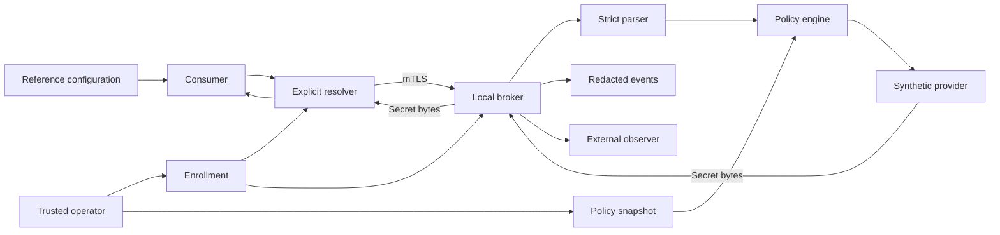

# System architecture

## Context and component model

The application owns configuration references. The broker owns identity
validation, authorisation and provider mapping. The provider supplies bytes
only after authorisation. The OS and TLS stack supply the chosen transport
boundary; a telemetry sink records decisions, never values.

This is a proposed system, not components implemented in this repository.
A stopped process cannot reliably report its own termination; health monitoring
requires an observer with an independent lifecycle.

The [contracts](contracts.md) distinguish the core session's reported MVP
grammar/wire/policy from future provider and deployment hardening. The lifecycle
below describes security requirements; do not infer that its every step is
implemented or that durable event storage exists in the memory-only demo.

| Component | Responsibility | Prohibited behaviour |
| --- | --- | --- |
| Parser | Whole-string canonical validation | Repair ambiguous or encoded input |
| Client | Verify server, request reference, deliver bytes | Print, persist or export resolved values |
| Broker | Authenticate transport, limit work, coordinate lifecycle | Trust body identity or skip authorisation |
| Policy engine | Exact principal/reference/action allowlist | Treat reference knowledge as permission |
| Provider | Broker-owned identifier to bounded bytes | Accept arbitrary caller paths/endpoints |
| Telemetry | Versioned redacted access/health events | Record bodies, values, keys, tokens or raw provider errors |
| Health observer | Detect availability and integrity changes | Claim observation prevents tampering |

## Trust boundaries

| Boundary | Trusted evidence | Untrusted input and enforcement |
| --- | --- | --- |
| Application/configuration | None for authorisation | Strictly parse every reference |
| Client/broker | Verified enrolled certificate chain and identity | JSON claims, headers, names and PIDs confer no trust |
| Operator/control plane | Protected enrollment and policy snapshot | Writable policy, provider redirection and symlinks; reject unsafe startup |
| Broker/provider | Exact operator-controlled mapping | Provider errors, latency, versions and oversized values; sanitise and limit |
| Broker/events | Protected fixed-schema sink | Names may reveal metadata; pseudonymise |
| Host/service | OS separation only when installed and tested | Same-user inspection and root/admin remain residual risks |
| Build/distribution | Reviewed source and verified tools | Dependencies, PR code and downloaded artefacts are not inherently trusted |

The MVP authenticates possession of an enrolled key, not an executable.
Control-plane administration is not exposed through the data-plane resolve API.
A principal's permission is checked before exercising the broker's stronger
provider access, preventing an intentional credential-oracle/confused-deputy
design.

## Resolution lifecycle

1. Validate local endpoint, TLS enrollment, immutable policy/mappings and event
   sink before serving. Invalid required controls fail startup.
2. Client recognises a whole canonical reference and verifies broker identity.
3. Broker verifies the client certificate, applies request limits and derives
   principal identity from transport, not request fields.
4. Capture one immutable policy revision, parse the reference and apply exact
   `resolve` authorisation. Denial must not invoke the provider.
5. Record the access decision without sensitive identifiers. Required sink
   failure blocks release rather than silently losing access events.
6. Call the provider under the request deadline. Validate length, expiry and
   buffer ownership. Do not share values across requests.
7. Persist a redacted release-attempt event before sending bytes. Sink failure
   disposes of bytes and returns an explicit non-secret error.
8. Deliver bytes over authenticated TLS with response caching disabled.
9. Consumer uses bytes without logging and clears owned buffers on every path.

A release attempt is not proof of receipt or use. A crash between event write
and delivery can produce an attempt without receipt; a crash after delivery
cannot revoke bytes. Exactly-once secret use is not promised. Completion events,
if implemented, must distinguish attempted delivery from completed transport
write, not claim the application used the credential.

## Residence, caching and failure

Values exist in provider, broker, TLS/runtime buffers and application memory.
Prefer owned byte slices, but GC, immutable strings, transport buffering,
library copies and crash dumps defeat a general zeroisation guarantee. Clearing
owned buffers is best effort, not proof that all copies disappeared.

No broker/client value cache is selected for the MVP. Reauthorise every request.
Provider versions and optional expiry bound newly delivered values; the caller
may still retain old bytes. Revocation blocks future resolution, not prior
disclosure. Certificate expiry must be enforced per request on long-lived
connections or connections made short-lived; handshake-time validation alone
does not revoke an existing connection.

Deadlines bound response writing and cooperative provider execution. The current
trusted synchronous synthetic provider honours deadlines, but context cancellation
cannot forcibly preempt an arbitrary blocking provider. Bound goroutines and
release concurrency slots on cancellation. A provider that ignores cancellation
is not eligible without separately bounded process isolation.
Retry is a new authorised, observable request;
never automatically retry after ambiguous delivery. No fallback to plaintext,
stale cache or a different provider.

## Filesystem integrity and rollback

Policy is a startup-only immutable snapshot; change it through controlled
restart, not partial hot reload. Operator-owned policy, enrollment material and
parent directories must have verified ownership/access rights. Open once and
validate the opened object; check-then-reopen is a TOCTOU gap. Reject symlinks or
reparse points and unsupported permission checks for real-secret deployment.
These OS-specific checks are requirements, not claimed MVP implementation.

A trusted expected digest can detect change; a digest stored beside an
attacker-writable file is not a trust anchor. Signed policy needs an independently
trusted verification key. A signature alone does not stop rollback of an older
signed revision; anti-rollback needs an operator-controlled monotonic floor or
external authority. Neither privileged anti-rollback nor signed-policy
enforcement is claimed here.

The synthetic demo's independent compiled policy pin is SHA-256 over
`json.Compact` bytes. It is a bounded integrity demonstration under an intact
binary, not an operator enrollment/update system or privileged anti-rollback.

For a synthetic demo, broker and client can share a developer account. This
demonstrates protocol authorisation, not same-user isolation. Real-secret
deployment requires a least-privilege separate service identity, protected
provider credentials, key enrollment/rotation/revocation and OS permission tests.
References never supply broker URLs; server trust is enrolled independently of
consumer configuration. This prevents reference-driven SSRF/simple fake-server
substitution, not replacement of binaries/trust stores by a privileged attacker.
